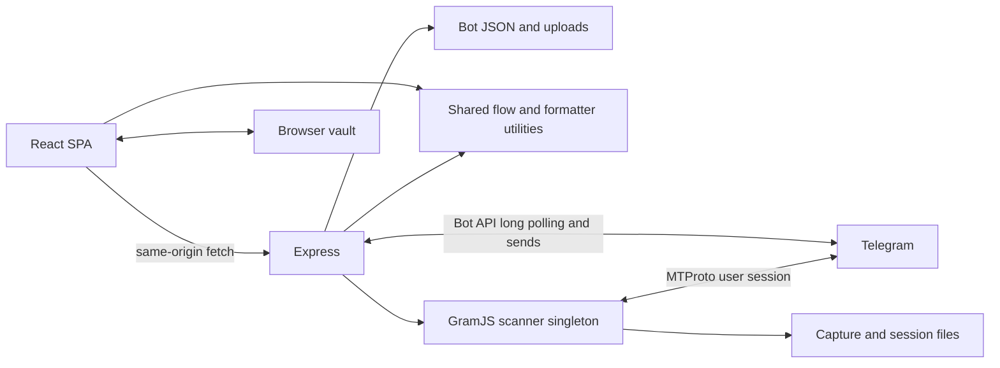
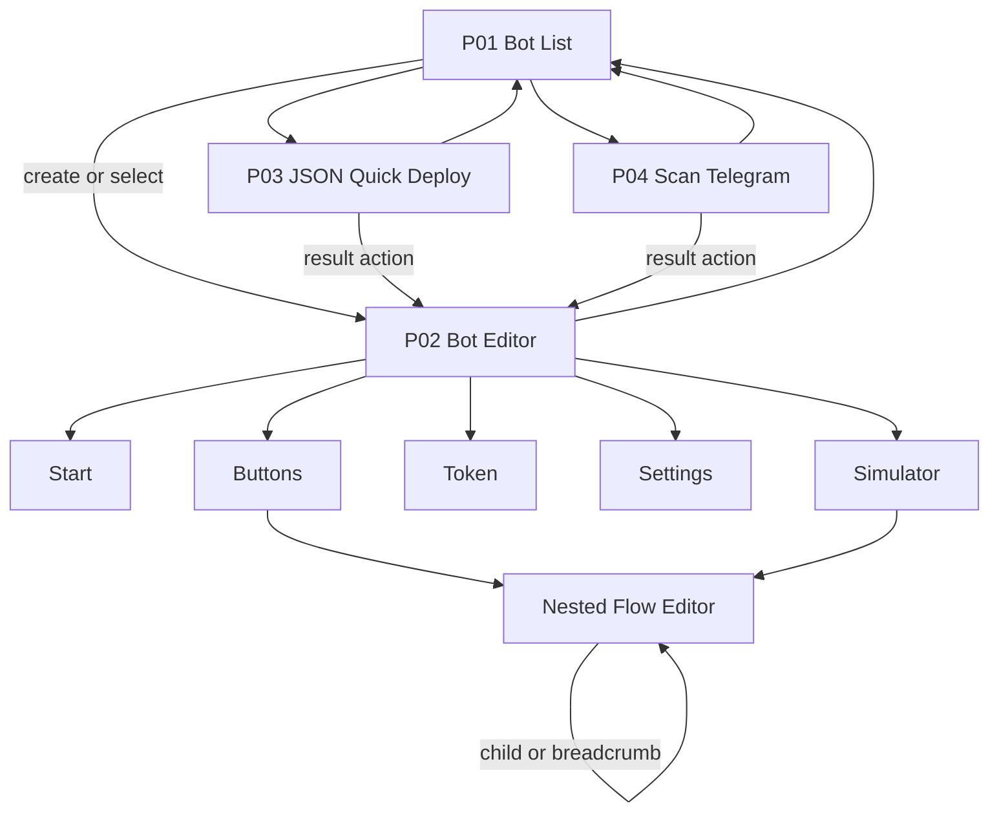
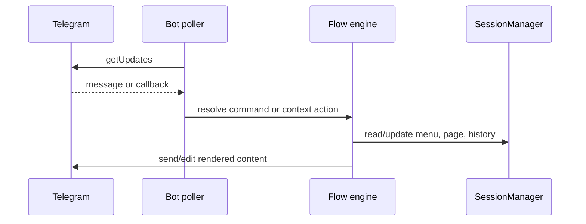

# تحليل TeleCraft Studio كما هو منفّذ | As-built System Audit

**النطاق:** مستودع `AkBotsBuilder2`، لقطة الأساس `bad94713177f87e5668b7a6fd3b281d8004898f9`. هذا تدقيق توثيقي فقط، لا إعادة تصميم ولا تعديل للتطبيق. **[كود]** دليل مباشر؛ **[استنتاج]** نتيجة من ربط فروع التنفيذ؛ **[اختبار]** تنفيذ فعلي لاختبار معزول؛ **[غير متحقق]** لا إثبات تشغيلي. المسارات أدناه نسبية إلى جذر المستودع، وأسماء الدوال محددات للبحث داخلها.

## 1. تعريف النظام وحدوده | System Overview & Boundaries

TeleCraft Studio لوحة عربية لتأليف بوتات Telegram وإدارتها: رسالة بداية، لوحتا Inline وReply، شجرات تدفق ووسائط، معاينة، ثم تشغيل باستخدام Bot Token. مسار JSON يستورد ويُحدّث التصميم؛ مسار Scan يحوّل محادثات ولقطات من حساب Telegram إلى تصميم قابل للتحرير. عنوان `index.html` هو هوية الواجهة، بينما `package.json` يسمي الحزمة `react-example`؛ لا يُستدل من اسم الحزمة على وظيفة المنتج. المستخدمون المستنتجون: مؤلف البوت من الويب، ومستخدم البوت من Telegram، ومشغّل يربط حساب Telegram لأغراض الالتقاط. هذه ليست أدوار RBAC.



**[كود]** `index.html` ← نقطة إدخال Vite، `src/main.tsx` يركّب React وCSS، `src/App.tsx` يملك اختيار القسم والبوت. `server.ts:startServer` يركّب REST وملفات `/uploads` ثم Vite middleware في التطوير أو `dist` مع SPA fallback في الإنتاج، ويستمع على `0.0.0.0:3000`. `npm run dev` و`npm start` يشغّلان `tsx server.ts`؛ التفريق يحصل بـ`NODE_ENV`. `npm run build` يبني الواجهة فقط، و`npm run preview` ليس بديلاً عن خادم REST. خادم طويل العمر وقرص قابل للكتابة مطلوبان لسلوك الاستمرار؛ لم يُراجع نشر فعلي أو منصة خارجية. `APP_URL` يدخل في بناء روابط الوسائط؛ `DISABLE_HMR` يضبط HMR ومراقبة الملفات؛ تعليق `GEMINI_API_KEY` ووسم Gemini في `metadata.json` لا يثبتان تكاملاً وظيفياً.

## 2. فهرس الشيفرة والاعتماديات | Repository & Dependencies

```text
/     index.html, package.json, bun.lock, vite.config.ts, tsconfig.json
      .env.example, .gitignore, metadata.json, SYSTEM_*_DOCUMENT*.md
      server.ts
server/ telegramScanner.ts
src/  main.tsx, App.tsx, index.css
      components/ (19 TSX)
      services/api.ts
      types/{bot,scan}.ts
      utils/ (8 وحدات و8 ملفات اختبار)
data/ bots.json, bots.json.bak, scan-captures.json
```

| ID | الوحدة والدليل | المسؤولية والاستخدام |
|---|---|---|
| M01 | `src/App.tsx` | مالك حالة التنقل وحالة مجموعة البوتات؛ يمرر البيانات والمعالجات عبر Props. |
| M02 | `src/services/api.ts` | واجهة Fetch نسبية، أخطاء عربية، تسلسل عمليات حسب bot ID، مصالحة وعمليات استرجاع للمخزن المحلي. |
| M03 | `server.ts` | CRUD، تحميل ملفات، حفظ واستعادة، Bot API، تنفيذ تدفق وإدارة Pollers. |
| M04 | `server/telegramScanner.ts:TelegramScannerService` | عميل GramJS واحد نشط، تسجيل دخول وحسابات محفوظة، التقاط أحداث وإعادة بناء مسارات. |
| M05 | `src/types/bot.ts`, `src/types/scan.ts` | عقود TypeScript للبوت والتدفق والجلسة والالتقاط؛ ليست تحققاً كاملاً من مدخلات HTTP. |
| U01 | `botPersistence.ts:reconcileBots` | جمع نسخ الخادم والمتصفح بقواعد الزمن والحذف؛ يدعم Local Storage وIndexedDB. |
| U02 | `botBackupExport.ts:downloadBotBackupFile` | إنشاء اسم وJSON وبدء تنزيل من محرّر البوت؛ يختلف عن تصدير التصميم. |
| U03 | `flowEngine.ts:resolveMenuView,findContextAwareReplyAction,resolveSlashCommand` | حسم القائمة الحالية ولوحتها، مطابقة Reply في سياقها ثم fallback، وتوجيه الأوامر. |
| U04 | `pagination.ts:resolvePageView,SessionManager` | توزيع تلقائي أو صفحات مُعرّفة، ضبط فهرس الصفحة، تشكيل عناصر تنقل، جلسة محادثة. |
| U05 | `telegramFormatters.ts` | تحويل أزرار إلى Telegram payload؛ قواعد النوع وURL وcallback UTF-8؛ صفوف، ترتيب وتكرار الشجرة. |
| U06 | `telegramDelivery.ts` | تنقية HTML/Markdown عند فشل الصياغة، خيارات الطلب وقرار إعادة تشغيل Poller وتصنيف الخطأ. |
| U07 | `jsonBotBlueprint.ts:parseBotDesignJson,autoFixJsonCode,applyBlueprintUpdates` | تفسير وتنظيف أشكال JSON وإنتاج نسخة معاينة وتصدير تصميم. |
| U08 | `scanBlueprintBuilder.ts:buildBlueprintFromCapturedBot` | تحويل نص وكيانات Telegram ووسائط وأزرار وعلاقات أحداث إلى Blueprint؛ لا يستعيد منطق المصدر غير المرئي. |

React/React DOM للعرض، Vite وReact plugin للبناء، Tailwind CSS 4 وVite plugin للتنسيق، Lucide للأيقونات، Motion للحركة، Express لـHTTP، Multer للرفع، GramJS لحساب المستخدم، Node FS وHTTPS والحزم القياسية للحفظ والتسليم. `dotenv` للإعداد، `tsx` للتنفيذ، TypeScript و`@types/*` للتحقق. `@google/genai` معلن، لكن لم يُثبت استخدام وظيفي في المسارات المدققة؛ لا حكم بالحذف أو الهجر. ملفا `SYSTEM_*` وثائق سابقة وليسا مصدراً حاكماً لسلوك التنفيذ. ملفات `data/` بيانات متتبعة لا أصول تجميلية ولا يُفترض أنها بيانات وهمية؛ لا تُعاد طباعة قيمها.

## 3. خريطة التنقل ومواصفات الشاشات | Sitemap & Screens



**[كود]** لا يوجد Router في التركيب الرئيسي. `App` يقرر العرض بالأولوية: بوت محدد، Scan، JSON، القائمة. `activeTab` و`flowStack` ليست معاملات URL؛ لا توجد روابط مباشرة مثبتة للكيانات، ولا شاشة 404 خاصة بالواجهة؛ زر رجوع التطبيق يصفّر الاختيارات ويعيد التحميل، وليس Back في سجل المتصفح. إعادة تحميل المتصفح لا تحفظ اختيار التبويب. شريط `Navbar` جزء دائم من Shell، ويبدّل الأفعال المتاحة حسب السياق.

| ID | البنية والسلوك | حالات وفروع |
|---|---|---|
| P01 | `BotList`: عرض البوتات، اختيار بطاقة أو إنشاء، فتح JSON/Scan، حذف بتأكيد. | تحميل، قائمة فارغة، بطاقات بحالة اتصال، فشل تحميل في Banner قابل للإغلاق؛ إلغاء الحذف لا يرسل الطلب. |
| P02 | `BotEditor`: رأس اسم وحالة ومزامنة وتنزيل وعودة، وتبويبات تحرير. `flowStack` يدعم دخول فرع وعودته. | عمود المحاكي للتبويبات العادية؛ تبويب المحاكي له عرض خاص؛ تغيير bot ID يعيد تركيب المحرّر. اتصال Telegram ليس شرطاً لتحرير التصميم. |
| P03 | `JsonQuickDeploySection`: النص أو الملف أو مثال أو تصميم بوت قائم، ملخص وتحليل ومعاينة، لوحة توكن وإجراءات الحفظ أو التفعيل أو التحديث. | JSON فارغ/معطوب/صالح، تقرير إصلاح، انتظار، رسالة نجاح/خطأ. نتيجة الإنشاء لا تفتح المحرر تلقائياً في المعالجات الرئيسية. |
| P04 | `ScanTelegramSection`: حالة الحساب، طرق الدخول والحسابات المحفوظة، سجلات، محادثة، محاكاة، تصدير أو إنشاء. | منفصل/بانتظار رمز/بانتظار كلمة مرور/متصل؛ سجل فارغ، مزامنة أو التقاط قيد التنفيذ، اختيار سجل ومعاينته، إيقاف الالتقاط وخطأ اتصال. |

## 4. سجل المكونات والعناصر | Component & Element Inventory

كل صف يصف مكوّناً مستقلاً؛ الملفات في `src/components/` بالاسم نفسه. هذه مواصفات على مستوى المكوّن والعناصر الوظيفية الرئيسية، وليست جرداً لكل عقدة DOM أو Variant بصري.

| ID | المكوّن / السياق | العناصر والبيانات والانتقال |
|---|---|---|
| C01 | `Navbar` / Shell | تبديل البوت والقسم والتبويب والثيم عبر callbacks؛ الاختيار من Props وليس حالة خادم مستقلة. |
| C02 | `BotList` / P01 | بطاقات وحالة الاتصال، إجراءات إنشاء وفتح، `handleDeleteConfirm` مع `ConfirmModal`. |
| C03 | `BotEditor` / P02 | تحرير الاسم، المزامنة والنسخة الاحتياطية، تبويبات، فتح Flow بأزرار المحرر والمحاكي؛ `handleSelectStackIndex` يقص مسار المحرر. |
| C04 | `StartMessageSection` / P02 | نص وتحليل وتجاوز ورسالة محفوظة، خيارات ووسائط؛ `handleSave` يرفع تحديث `startMessage`؛ الحذف يمر بتأكيد. |
| C05 | `ButtonsSection` / P02 | Inline وReply مستقلان، إنشاء/تعديل، تحريك، تكرار وحذف، فتح محرّر تدفق؛ يربط قوالب الصفوف وPagination لكل نوع. |
| C06 | `UnifiedButtonForm` / إنشاء وتعديل | نوع ونص ومظهر وإجراء ومعلمات نوعية؛ تبويبات رسالة ووسائط وإجراءات وأزرار فرعية وتنقل؛ `handleSubmit` يبني حمولة للوالد ويمكن طلب الذهاب للتدفق. |
| C07 | `ButtonFlowEditor` / P02 Flow | `saveFlow` ينقل تحديث التدفق؛ وضع ورسالة ووسائط وإجراءات مرتبة قابلة للتعطيل وأبناء؛ تنقل breadcrumbs وفتح فرع تابع، وتخصيص Reply وPagination. |
| C08 | `TokenSection` / P02 | إدخال وتنظيف وفحص صيغة التوكن، اتصال وفصل، تغذية راجعة وتحديث بعد الطلب؛ التحقق المحلي لا يثبت ملكية البوت. |
| C09 | `BotSettingsSection` / P02 | ملف البوت ووصفه وقائمة الأوامر وربطها بالتدفق وخيارات API؛ `handleSaveAll` يميز الحفظ عن طلب المزامنة. |
| C10 | `TelegramSimulator` / P02/P03/P04 | محادثة وحالة لوحة محلية، إدخال نص، Inline callbacks وReply والنقل بين الصفحات؛ يمكن حفظ تغيير التخطيط عند توفر callback؛ Scan يستطيع تمرير بعض الأفعال إلى حساب حقيقي عبر callbacks. |
| C11 | `SimulatorQuickEditor` / C10 | تحرير بيانات زر، رسالة تدفق، وسائط وأبناء؛ إضافة وتكرار وحذف فرعي؛ ليس حساب Telegram مستقلاً. |
| C12 | `PaginationSettingsModal` / محررات الأزرار | تلقائي أو يدوي، صفحات ونسخها وترتيبها، توزيع الزر على صفحة، عناصر التنقل ومؤشر؛ `handleSave` يعيد إعدادات إلى الوالد. |
| C13 | `RowArrangerModal` / تنظيم اللوحات | صف جديد وفصل ودمج وتحريك وأوامر اتجاهات وDrag-and-drop؛ `handleSaveArrangement` يحوّل المسودة إلى ترتيب محفوظ. |
| C14 | `MediaUploader` / تأليف الرسائل | اختيار ملف أو وسيط بالرابط، رفع ثم إضافة كـ`MediaItem`؛ حذف وإعادة ترتيب، Spoiler وموضع Caption. رفع الملف وحفظ التصميم عمليتان مختلفتان. |
| C15 | `MessageOptionsPanel` / تأليف الرسائل | حقول effect والحماية والتنبيه ومعاينة الرابط؛ يحول UI إلى `TelegramMessageOptions` التي يقرأها المرسل. |
| C16 | `TelegramApiInspectorModal` / C10 | تبويب Inline وReply وDocs، يعرض حمولة مشتقة من العرض الحالي ويمكن نسخها؛ ليس إرسالاً تجريبياً للشبكة. |
| C17 | `ConfirmModal` / إجراءات حذف | عنوان ومحتوى وConfirm/Cancel من الوالد، حالة انشغال، `role=dialog` و`aria-modal`. |
| C18 | `JsonQuickDeploySection` / P03 | تحليل وإصلاح وإعادة تنسيق ونسخ وتحميل ملف وإظهار Preview؛ تفاصيل الفروع في J04. |
| C19 | `ScanTelegramSection` / P04 | دورة الحساب والالتقاط والربط والتصدير والإنشاء؛ تفاصيل الفروع في J05–J06. |

## 5. الرحلات وتدفق الأحداث | Journeys & Event Flows

### J01 — من الواجهة إلى مسودة | Create and Manage Draft

1. على تحميل التطبيق، `App.loadBots → api.getBots`: تُطلب نسخة الخادم وتُصالَح مع Browser Vault؛ تظهر قائمة أو فراغ، أو Banner إذا رُمي خطأ. يمكن العودة إلى القائمة لإعادة الطلب. لا توجد خطوة تسجيل دخول للتطبيق.
2. «إنشاء» → `handleCreateNewBot → api.createBot → POST /api/bots`؛ الخادم يخصص السجل ويكتبه، والواجهة تضيفه وتحدد `start`. الفشل يترك المستخدم دون انتقال نجاح. اختيار بطاقة موجودة يتجاوز الإنشاء ويفتح `start` مباشرة.
3. حفظ رسالة البداية أو اسم أو إعداد → معالج المكوّن → `App.handleUpdateBot`: دمج متفائل ثم `PUT` متسلسل؛ قبول أحدث استجابة للتعديل نفسه، واسترجاع النسخة السابقة عند فشل آخر تعديل؛ للوالد/المكوّن أن يعرض الخطأ. تغير البوت المختار يعيد تركيب المحرر.
4. تنزيل النسخة من رأس المحرر يبدأ تنزيل JSON في المتصفح ولا ينشئ بوتاً. العودة تستدعي تحميل القائمة. حذف من القائمة يطلب تأكيداً؛ الإلغاء يبقي السجل، والتأكيد الناجح يحذفه من القائمة ويوقف تشغيله على الخادم. `botPersistence` يسجل الحذف لكي لا تعيده المصالحة.

### J02 — تصميم لوحة وفرع ومعاينتهما | Design, Nest & Preview

1. في P02 افتح Buttons وحدد Inline أو Reply. «إضافة» يفتح `UnifiedButtonForm`. الحقول تتبع النوع والإجراء؛ فحص ملاءمة الحقول يتم قبل رد `onSave`، لا بمجرد عرض نموذج. `ButtonsSection.handleUnifiedSave` يحدّث اللوحتين/خريطة التدفق حسب سياق الإنشاء أو النقل بين النوعين.
2. افتح تدفق الزر من القائمة أو المحاكي → `BotEditor.handleOpenFlow` يضعه في المكدس. تعديل النص/الوسائط/الأفعال → `ButtonFlowEditor.saveFlow`؛ «فتح طفل» يضيف عقدة للمكدس، والعودة تقصه أو تعيد تبويب الأزرار. إلغاء نموذج لا يساوي حذف التدفق؛ الحذف المؤكّد يستخدم معرّفات الأبناء لتفادي بقايا فروع شجرته.
3. يمكن ترتيب صفوف الأزرار بـC13 أو توزيعها عبر C12؛ الحفظ يرسل إعداد تخطيط أو ترقيم للوالد. يدعم النموذج اليدوي اختيار IDs وخصائص صفحة مستقلة، مثل رسالة ووسائط وتنقل؛ عرض الصفحة يضبط فهرساً خارج الحدود.
4. في C10، إرسال `/start` أو ضغط زر يستدعي معالجات المحاكي ويبني عرضاً محلياً من BotConfig. الضغط على زر تنقل يغيّر الصفحة، وتحرير الزر السريع يسلك مسار تحديث التصميم إذا أُتيح. لا تستلزم المعاينة توكناً ولا تثبت أن Telegram قبل الطلبات المقابلة.

### J03 — الاتصال والتفاعل الحقيقي | Connect and Run

1. Token tab → `TokenSection.handleConnect`: تنظيف وفحص ثم `POST /api/bots/:id/connect`. في الخادم `verifyTelegramToken` يتحقق من الهوية عبر Telegram، ثم حفظ بيانات الاتصال وقدرات البوت، مزامنة الملف والأوامر وبدء Poller. صيغة غير صالحة توقف الرحلة مبكراً؛ فشل خدمة يعيد رسالة خطأ ويمكن إعادة المحاولة.
2. من Telegram، يرسل مستخدم البوت `/start` أو أمراً أو يضغط Inline/Reply. `startPolling` يحصل على التحديثات، ثم `handleTelegramMessage` و`executeFlow`/`renderMenu` يحدّثان سياق المستخدم ويرسلان أو يعدلان الرسائل. لا يعني تحديث الصفحة في الويب وجود مستخدم Telegram، ولا يعني اتصال التوكن أن كل Capability مسموحة.
3. مزامنة صريحة من المحرّر/الإعدادات تختلف عن تحديث تصميم محلي؛ `PUT` يحفظ أولاً ويطلق مزامنة خلفية عند تغيير profile/commands مع وجود اتصال. `GET status` كل 8 ثوانٍ للبوت المختار؛ فشل الطلب الخلفي صامت. فصل الاتصال يوقف Poller ويضبط `isConnected=false` لكنه لا يمحو التوكن (`server.ts:2017`).
4. الخادم يعيد محاولة تشغيل Pollers المؤهلة عند الإقلاع وكل 15 ثانية، ويستخدم قرار صحة/توقف من U06. فروع unauthorized/conflict/transient مختلفة؛ لا ضمان لإيصال كل رسالة عند تعطل الخدمة. لم تُختبر الدورة الحقيقية في Telegram.



### J04 — JSON من الإدخال إلى نتيجة | Import, Repair, Deploy

`JsonQuickDeploySection` يقبل النص/مثال/ملف أو تصدير سجل موجود. `parseBotDesignJson` ينتج Blueprint وملخصاً أو خطأ؛ `autoFixJsonCode` يحاول الإصلاح ويعاد التحليل، ولا يُرسل JSON غير صالح لمجرد وجود نص. المعاينة تنتج بوتاً محلياً. أمام المستخدم ثلاثة نهايات:

- **Draft:** `handleSaveDraftWithoutToken → POST /api/bots` بالتصميم. نجاح يعرض نتيجة ويضيف السجل؛ لا يشغل Poller ولا يتطلب توكن.
- **Activate:** `handleActivateInTelegram` يتحقق من التوكن ثم `POST /api/bots/import-and-connect`. الخادم يتحقق ويحفظ ثم يزامن ويبدأ التشغيل؛ حفظ السجل يحدث قبل بعض العمل الخارجي، لذلك رسالة خطأ لا تثبت التراجع عن كل أثر سابق.
- **Update existing:** `handleUpdateAndSyncSelectedBot` يشترط اختيار مصدر؛ يحفظ بـ`PUT` ويزامن إن كان للسجل توكن، وإلا يعيد جلبه. فشل المزامنة بعد قبول `PUT` لا يتراجع تلقائياً عن التصميم. يمكن تصحيح المدخل وإعادة المحاولة أو ترك الشاشة؛ لم يُثبت Cancel لطلب نشر بدأ بالفعل.

### J05 — ربط حساب Scan | Scan Account Session

دخول P04 → `loadStatusAndCaptures` يجلب الحالة والسجلات ويكرر التحديث بفاصل. ربط Session String يرسل بيانات جلسة مع `apiId/apiHash`؛ البديل `handleStartPhoneLogin` يرسل رقم الهاتف، ثم `handleVerifyPhoneCode` يرسل الرمز أو كلمة المرور إن طلبت MTProto التحقق الإضافي. الرفض يبقي حالة قابلة للتصحيح حسب رد الخادم. النجاح يحدّث حالة الحساب والحسابات المحفوظة. يمكن تغيير الحساب المحدد أو حذف المحفوظ بعد التأكيد أو الفصل مع خيار مسح الجلسة. هذه مصادقة Telegram وليست صلاحية دخول إلى لوحة الويب.

### J06 — التقاط ثم تصدير | Capture to Blueprint

1. اختر بوتاً أو هدفاً، أو اطلب مزامنة المحادثات السابقة. `TelegramScannerService` يلتقط رسائل جديدة ومعدّلة ويحفظ سجل أحداث، ومعالج مزامنة التاريخ يسترجع ما توفر. لا يلزم وجود سجل سابق للاتصال، لكنه يلزم لعرض نتائج البناء.
2. من سجل مختار، يمكن إرسال نص أو تفعيل زر Inline حقيقي (`interact`) أو استخدام إجراءات الالتقاط الجماعي. الحالة وتقدم الالتقاط تظهر في P04، و`stopCrawl` يطلب إيقاف العملية لا إلغاء آثار التفاعل السابق. تنقل أو ردود غير متاحة قد تترك لقطة جزئية. لا يوجد إثبات لشمول كل مسار من بوت المصدر.
3. `handleLinkStep` يربط يدوياً حدثاً بوالد عندما يلزم؛ `buildBlueprintFromCapturedBot` يحوّل العلاقات والرسائل والأزرار والوسائط إلى تصميم؛ يمكن النسخ/التنزيل أو `handleSaveAsDraft` أو `handleDeployWithToken`. نجاح الحفظ يضيف سجلاً مستقلاً في القائمة، لا يعدّل مصدر المحادثة. الإخفاق يعرض خطأ ولا يعادل مسح الالتقاط؛ حذف السجل بإجراء منفصل ومؤكّد.

## 6. قواعد البيانات والحالة | Business Rules, Data & State

| ID | الحقيقة التنفيذية | الدليل |
|---|---|---|
| D01 | `BotConfig` يحمل الهوية والأزمنة والاتصال، البداية واللوحتين، تدفقات رقمية بالمعرّفات، الترقيم والتخطيط والإعدادات والملف والأوامر. الخادم يدمج PATCH منطقياً عبر `PUT` بدمج سطحي؛ يحمي `id` ويولّد `updatedAt`، فلا يُفترض دمج كائن فرعي عميق. | `types/bot.ts`, `server.ts:1793` |
| D02 | `BotButton` ينتمي إلى Inline أو Reply، مع row/order ومعلمات نوع الإجراء. `ButtonFlow` يضم رسالة قابلة لأن تكون null، وسائط وأبناء وأفعالاً مرتبة. قواعد واجهة التحرير وصياغة الطلب ليست ضماناً لقبول جميع ميزات Telegram. | `types/bot.ts`, `telegramFormatters.ts:validateInlineButton,validateReplyButton` |
| D03 | `ManualPage` يخصص IDs ومواضع ورسالة ووسائط وإعدادات؛ `resolvePageView` يطبق تخصيص الصفحة ويتحقق من مجال الفهرس. الترقيم منفصل عن ترتيب صفوف العرض، ويؤثر `updateMode` على محاولة edit أو رسالة جديدة. | `pagination.ts`, `server.ts:renderMenu` |
| D04 | `UserSession` تتبع القائمة والصفحة والرسالة وسجل التنقل حسب bot/chat/user؛ `SessionManager` في ذاكرة العملية فلا يدوم تاريخ المحادثة التطبيقي بعد restart. محادثة المحاكي منفصلة وتُدار في React. | `types/bot.ts`, `pagination.ts:705`, `TelegramSimulator.tsx` |
| D05 | `CapturedBotRecord` مجموعة أحداث مرتبطة ببوت، و`CapturedMessageEvent` يصف رسالة/تعديلاً مع كيان نص أو مرفق وأزرار وسياق trigger. منها ينتج Blueprint، وليست سجلات Scanner هي قائمة `BotConfig`. | `types/scan.ts`, `telegramScanner.ts`, `scanBlueprintBuilder.ts` |
| D06 | الخادم يقرأ ملف البوتات ويملك Cache وطابور كتابة ونسخة احتياطية. المتصفح يخزن سجلات وtombstones في Local Storage وIndexedDB؛ المصالحة تُرجع أيضاً سجلات للاستعادة ومعرّفات للحذف. لا يوجد محرك SQL مثبت. | `server.ts:75–139,1583`, `botPersistence.ts:30,147–232` |
| D07 | الخادم يخزن حسابات Scanner في `data/scan-sessions.json` مع دعم ملف جلسة قديم؛ بيانات الالتقاط في `scan-captures.json`؛ حالة الاتصال والتحقق الجاري عميل Singleton في الذاكرة. الوسائط تحت `uploads/` وقد تستخدم روابط خارجية. | `telegramScanner.ts:69–106`, `server.ts:38–70,449,1572` |
| D08 | ثيم الويب في `telecraft_theme` وعلى `html.dark`؛ اختيار القسم/التدفق، مسودات الحقول والمؤشرات حالات React؛ ثيم المعاينة من إعدادات التصميم وليس إثباتاً لتفضيل تطبيق Telegram. | `index.html`, `App.tsx`, `types/bot.ts` |

**التنفيذ الخلفي:** `executeFlow` يميز أفعال chat action وalert وreaction وdice وpoll وchecklist وdraft stream عن إرسال/تعديل/حذف رسالة أو وسائط وتحريك السياق. الحالات المصرّح بها في `FlowActionType` ليست متساوية التنفيذ؛ بعض الأفعال تمر بالعرض الافتراضي أو ترتبط بقدرات Telegram ونوع المحادثة. فحص كل فعل على كل سياق غير منجز. `sendMediaItems` و`callTelegramApiWithFallback` يعالجان حالات التسليم والتنسيق؛ لا ينبغي مساواة fallback بتطابق بصري كامل. [الدليل: `server.ts:298,351,709–1066`].

## 7. سجل REST والتكامل | API Contracts & Integration

المسارات أدناه معرّفة في `server.ts:1577–2265`، والمستهلك الرئيسي `src/services/api.ts`. الأعمدة تعرض الحقول المركزية لا مخطط OpenAPI كاملاً. الجسم عادة JSON، والرفع multipart؛ limit لـJSON هو 20 MB وللملف 25 MiB. أخطاء الأعمال غالباً `{error}`، مع فروع Validation، Not Found، وأخطاء اتصال أو حفظ؛ لا يُفترض توحيد أخطاء Middleware.

| ID | Method & Path | مدخل → مخرج |
|---|---|---|
| A01 | `GET /api/bots` | بلا مدخل → `BotConfig[]`. |
| A02 | `POST /api/bots/restore` | `bots,deletedIds` → `{bots}` بعد المصالحة. |
| A03 | `POST /api/bots` | `name?,blueprint?` → سجل بوت. |
| A04 | `POST /api/bots/import-and-connect` | `blueprint,token` → `success,message,bot,telegramInfo` عند النجاح. |
| A05 | `GET /api/bots/:id` | `id` → سجل؛ 404 إذا غاب. |
| A06 | `PUT /api/bots/:id` | `id` وإعدادات جزئية → سجل مدمج ومؤرخ؛ 404 إذا غاب. |
| A07 | `DELETE /api/bots/:id` | حذف السجل وإيقاف التشغيل؛ خدمة العميل تحدّث Vault بعد الطلب. |
| A08 | `POST /api/bots/:id/connect` | `token` → التحقق وتحديث الاتصال وبيانات البوت. |
| A09 | `POST /api/bots/:id/disconnect` | إيقاف التشغيل → `{success,message,bot}`. |
| A10 | `POST /api/bots/:id/sync` | إعادة مزامنة الملف والأوامر ومتابعة حالة التشغيل → `{success,message,bot}` عند النجاح. |
| A11 | `GET /api/bots/:id/status` | `{exists,isPolling,lastCheck,lastError,isConnected,botUsername?,botFirstName?}`؛ قد يشغّل إصلاح Poller؛ `exists=false` ليس 404. |
| A12 | `POST /api/upload` | multipart `file` → `{url,fileName,size,mimetype}`؛ 400 إذا غاب الملف. |
| A13 | `GET /api/scan/status` | `ScanStatusResponse`، يتضمن الاتصال والتقدم عند توفره. |
| A14 | `POST /api/scan/connect` | `apiId,apiHash` ومسار `sessionString` أو `phoneNumber` → الحالة أو خطوة التحقق. |
| A15 | `POST /api/scan/verify-code` | `code` أو `password` → حالة الجلسة. |
| A16 | `POST /api/scan/disconnect` | `clearSession` → حالة بعد الفصل. |
| A17 | `POST /api/scan/switch-account` | `savedId` → حالة الحساب المختار. |
| A18 | `DELETE /api/scan/accounts/:savedId` | حذف حساب محفوظ → الحالة. |
| A19 | `POST /api/scan/sync-telegram` | `botUsernameOrKey?` → `{bots}` بعد المزامنة. |
| A20 | `POST /api/scan/target-bot` | `targetBot` أو null → حالة مرشح الالتقاط. |
| A21 | `GET /api/scan/bots` | `{bots}`، سجلات الالتقاط. |
| A22 | `GET /api/scan/bots/:botKey` | سجل محدد؛ لا معالج عميل مباشر مطابق في `api.scan`. |
| A23 | `POST /api/scan/interact` | الهدف، نوع الفعل، نص أو مرجع Inline وسياق الوالد → سجل وalert اختياري. |
| A24 | `POST /api/scan/crawl` | هدف وحدود اختيارية → تقدم وسجل. |
| A25 | `POST /api/scan/crawl/stop` | طلب إيقاف → `{crawlProgress}`. |
| A26 | `POST /api/scan/bots/:botKey/link-step` | `eventId,targetParentId` → `{bot}` بعد إصلاح الربط. |
| A27 | `PATCH /api/scan/bots/:botKey` | `customName` → `{bot}` باسم مخصص. |
| A28 | `DELETE /api/scan/bots/:botKey` | حذف سجل الالتقاط. |

**حدود الثقة والصلاحيات | Access Matrix**

| الطرف | العمليات الظاهرة في الكود | الحدود |
|---|---|---|
| زائر يستطيع بلوغ لوحة الويب | يُعرض له مسار القائمة والتحرير والاستيراد وScan؛ لا تظهر حراسة تطبيقية قبل REST. | ليس دور مدير مثبتاً. حواجز Proxy أو المنصة خارج النطاق وغير متحققة. |
| مؤلف يحمل Bot Token صالحاً | يمكنه طلب ربط البوت وتشغيل Poller والمزامنة. | Telegram يتحقق من التوكن؛ هذا ليس حساب المستخدم في التطبيق ولا عزل بيانات بين المؤلفين. |
| صاحب جلسة مستخدم Telegram | يمكنه استخدام وظائف الحساب الحقيقي بعد اتصال Scanner. | جلسة Telegram لا تحكم وصول زائر الويب إلى REST؛ توجد حالة Scanner مشتركة داخل العملية. |
| مستخدم Telegram الذي يكلم البوت | أوامر ورسائل وأزرار يرد عليها Bot API وفق سياق المحادثة. | لا يكتسب صلاحية لوحة الويب من هذه الرحلة. |

**ملاحظة أمان دفاعية:** واجهات قراءة BotConfig ترجع السجل مباشرة، ونموذجه يتضمن توكناً اختيارياً؛ جلسات Scanner ومخزن المتصفح طبقات بيانات حساسة. لا يُنصح بإتاحة التطبيق مباشرة لجهات غير موثوقة دون مصادقة وعزل ومراجعة طريقة حفظ الأسرار وتصديرها. التقرير لا ينشر قيماً من البيانات.

## 8. التصميم والتجاوب والوصول | Design, Responsive & Accessibility

- **[كود]** وثيقة HTML عربية RTL، ومناطق تقنية أو نصوص أجنبية يمكن عرضها LTR. Cairo بأوزان 400–800 مع fallback، وJetBrains Mono محمّل من Google Fonts؛ تعطل الشبكة لا يعني عدم ظهور النص. الألوان العامة من Tailwind: خلفية `#F2F7FC` و`slate-950` في الداكن، سطح أبيض/Slate، Sky للإجراءات وRose للأخطاء. `.dark` هو مفتاح theme و`color-scheme` تتبعه. الـScrollbar المخصص 6px؛ التصميم يمزج قيم Tailwind وقيم arbitrary بدلاً من ملف Tokens مركزي شامل. [الدليل: `index.html`, `src/index.css`, `App.tsx`].
- **[كود]** `BotEditor` يوزع المحرر 7 أعمدة والمحاكي 5 على `lg`، والمحاكي Sticky على الشاشات الكبيرة؛ أسفل ذلك تُكدس الأقسام. Scan يغيّر ترتيب الرأس والمحاذاة في `sm` و`lg`. `sm/md/lg` هي Tailwind variants، ليست قياسات ميدانية. الأزرار ذات الاتجاهات في منظم الصف توفر بديلاً لعمليات سحب محددة؛ لم يُختبر اللمس ولا قص النص العربي الطويل.
- **[كود]** `main` دلالي، وعناصر كثيرة أزرار فعلية. `ConfirmModal` يصرّح بخصائص الحوار، وScan يضع `aria-label` على بعض الأزرار و`aria-selected` في طرق الدخول. وجودها لا يثبت التركيز الأولي، حصر/استعادة التركيز، تغطية التسميات، أو الإعلان الصوتي عن الأخطاء. لا يوجد تحقق من التباين أو قارئ الشاشة أو الحركة المخفّضة. توجد انتقالات ألوان 200ms في Shell وإشارات انتظـار تدور في أزرار؛ يلزم تحقق أداء وReduced Motion في المتصفح.

## 9. حالة التنفيذ والجودة | Implementation Status & QA

| ID | المجال | التصنيف وأساسه |
|---|---|---|
| Q01 | القائمة/التحرير/التخزين/الترقيم | تنفيذ وظيفي في الكود، واختبارات للوحدات المشتركة؛ تشغيل المسار كاملاً غير متحقق. |
| Q02 | المحاكي وInspector | تنفيذ محلي، ومخرجات Inspector محسوبة؛ ليس Live Telegram. تكامل Scan مع المحاكي استثناء مشروط. |
| Q03 | JSON | تنفيذ للتحليل والإصلاح والحفظ والتفعيل؛ لا ضمان إصلاح أي JSON أو أن المزامنة عملية ذرّية. |
| Q04 | الالتقاط | تنفيذ؛ استعادة منطق المصدر أو الحالات غير المرئية جزئية بطبيعتها، وتوافق Telegram الحقيقي غير متحقق. |
| Q05 | الأدوار وعزل البيانات | لا حراسة على طبقة التطبيق ضمن المسارات المدققة؛ عزل نشر خارجي غير معروف. |
| Q06 | Gemini | اعتماد ووصف إعداد؛ استخدام فعلي غير مثبت، وليس وظيفة مكتملة بمجرد وصف metadata. |
| Q07 | Offline | Vault يعالج أنماط فقد الشبكة/السجل، لكنه لا يحول التشغيل والمزامنة والرفع إلى وظائف Offline كاملة. |

**[اختبار]** شُغّل `npm exec --yes --package=tsx -- tsx --test src/utils/*.test.ts` على Node `v22.22.3`: **55 ناجحة، صفر فشل، صفر تخطٍّ**. ثمانية ملفات `node:test`: `botBackupExport`، `botPersistence`، `flowEngine`، `jsonBotBlueprint`، `pagination`، `scanBlueprintBuilder`، `telegramDelivery`، `telegramFormatters`. النتيجة لا تُحسب تغطية أسطر ولا تثبت التفاعل مع REST أو Telegram. لم يُشغّل خادم التطبيق على البيانات الموجودة لأن `startServer` يستأنف تشغيل الحسابات والبوتات المؤهلة تلقائياً؛ لم يُجرَ تحقق متصفح، بناء إنتاج، فحص TypeScript، تحميل، أداء، أو E2E.

**متطلبات تحقق مقترحة (وليست نتائج):** J01 مصالحة نسخة أقدم/حذف وتحديثات متزامنة وفشل الحفظ؛ J02 صفحات يدوية وحذف فرع وتطابق المعاينة مع formatter؛ J03 رفض توكن وإعادة اتصال وفشل مؤقت وسلوك فصل وإعادة تشغيل؛ J04 معطوب قابل للإصلاح وتحديث ناجح مع Sync فاشلة؛ J05 جلسة اختبار معزولة تشمل التحقق الإضافي؛ J06 سجل جزئي ووسائط مفقودة وإيقاف عملية قيد التنفيذ؛ اختبار Keyboard وfocus وحالات أخطاء مقروءة وتغير التخطيط على شاشات متعددة.

## 10. خلاصة وتقدم العمل | Findings, Progress & Final Audit

| المحور | المنجز / أساس التغطية | المتبقي وغير المتحقق |
|---|---|---|
| اكتشاف المستودع | جرد 56 مساراً متتبّعاً قبل الوثيقة | ليست نسبة قراءة سطرية؛ سجلات البيانات لم تُنسخ أو تُفحص سجلّاً بسجلّ. |
| شاشات Shell ومكونات React | 4 عائلات عرض حسب فروع `App`، و19/19 ملف مكوّن في السجل | مواصفات لكل عنصر DOM وحالات الصفحات الفرعية الدقيقة ليست مكتملة. |
| معمارية وREST | الوحدات الأساسية، 28/28 تسجيل REST ظاهر، إضافة إلى Static وSPA fallback | تدقيق حمولة كل رد وحالة HTTP واختبارها، ومراجعة أحمال وتزامن متعدد العمليات. |
| رحلات المستخدم | 6 رحلات من القائمة أو الاستيراد أو Scan إلى التأليف/الاتصال/النسخ | تشغيل طرفي وأدلة صور غير منفذين؛ فروع أكثر دقة لأفعال Telegram والـUX تحتاج متابعة. |
| الجودة | 8/8 ملفات اختبارات أصلية شُغّلت؛ 55/55 نتيجة ناجحة | لا توجد نسبة تغطية أسطر، ولا يُعمّم الرقم على باقي النظام. |
| الأدوار والوصول والتجاوب | مباشرة من الكود، مع تمييز ملاحظات المخاطر | صلاحيات الاستضافة الخارجية، قارئ الشاشة، قياسات المتصفح وتدقيق الوصول كاملاً غير متحقق. |

**أولويات مقترحة:** (1) حماية لوحة الويب وREST وفصل الأسرار عن بيانات العرض والتصدير، (2) بيئة تشغيل معزولة ببيانات آمنة لتوثيق حالات Telegram وبناء E2E، (3) التحقق من اتساق تخزين الإعدادات وحالة المزامنة بعد فشل جزئي، (4) جرد عناصر الوصول والتجاوب ميدانياً، (5) مراجعة ما يُستخدم فعلاً من الاعتماديات قبل اقتراح إزالتها. هذه اقتراحات منفصلة عن وصف النظام، ولم تُنفّذ.

**نتيجة المراجعة:** يغطي التقرير المعمارية ومسارات الاستخدام الرئيسة والمكونات والمسارات المسجلة على مستوى الجرد. لا أدّعي اكتمال تحليل جميع الفروع الداخلية أو التحقق البصري والتشغيلي؛ الأرقام أعلاه تقيس وحدات الجرد والاختبار المحددة فقط، ولا تصلح نسبةً إجمالية للنظام.
